**Português (Brasil)** · [English](README.en.md)

<a id="top"></a>

<p align="center">
  <picture>
    <source media="(prefers-reduced-motion: reduce)" srcset="docs/assets/readme/hero-still.svg" />
    
  </picture>
</p>

# Cérebro IA

**O harness que eu uso para construir sistemas com Claude Code e Codex.**

Eu sou o Rafael Braga. Construo, com IA, o sistema que o seu negócio ainda faz na mão. Este repositório é o meu cérebro aberto: as regras, as skills e os prompts que fazem o Claude e o Codex trabalharem como um time disciplinado, e não como um gerador de código que sai fazendo na primeira interpretação.

Você cola uma linha, o agente instala a base na sua máquina e no seu projeto, e verifica.

<p align="center">
  <a href="#instalar"><strong>INSTALAR O HARNESS BASE →</strong></a>
  &nbsp; · &nbsp;
  <a href="docs/pt-br/mapa-de-skills.md">MAPA DE SKILLS</a>
  &nbsp; · &nbsp;
  <a href="#toolkit-completo">TOOLKIT COMPLETO</a>
</p>

<p align="center">
  <a href=".github/workflows/validate.yml"></a>
  &nbsp;
  <a href="LICENSE"><strong>MIT</strong></a>
</p>

---

<a id="instalar"></a>

## 00 / Instale a base com uma linha

Abra o Claude Code ou o Codex na pasta do seu projeto e cole:

```text
Leia https://raw.githubusercontent.com/rafabragatrause-cmd/cerebro-ia/main/HARNESS.md e execute a seção "Prompt" neste computador e neste projeto.
```

O agente faz o diagnóstico, mostra o que vai instalar, pede confirmação antes de mexer em configuração global e termina com um relatório do que foi verificado. Detalhes em [HARNESS.md](HARNESS.md).

| Camada | Skills | O que muda no seu dia |
|---|---|---|
| **Pensar** | `grill-me`, `brainstorming` | O agente aperta o seu plano antes de escrever a primeira linha |
| **Planejar** | `writing-plans`, `speckit`, `project-init` | Critério de aceite definido antes de começar |
| **Construir** | `ponytail`, `tdd` | Menos código, mais teste |
| **Revisar** | `code-review`, revisão cruzada com o Codex | Quem escreve não revisa |
| **Provar** | `browser-qa`, `agent-browser` | Tela vista, não tela imaginada |
| **Memória** | `learnings.md`, `HANDOFF.md`, `fechar-sessao` | A sessão de amanhã começa sabendo o que a de hoje descobriu |
| **Manter** | `context-budget` | O harness não vira peso morto |

## 01 / O que este repositório acrescenta

| Novo | Onde |
|---|---|
| Prompt de uma linha que instala o harness base | [HARNESS.md](HARNESS.md) |
| Mapa mental das skills, por momento do trabalho | [docs/pt-br/mapa-de-skills.md](docs/pt-br/mapa-de-skills.md) |
| Skills próprias: `project-init`, `fechar-sessao`, `context-budget`, `speckit` | [skills/](skills/) |
| Disciplina de sessão: critério de aceite, aprendizados e handoff | [docs/pt-br/disciplina-de-sessao.md](docs/pt-br/disciplina-de-sessao.md) |
| Revisão cruzada Claude ↔ Codex | [docs/pt-br/revisao-cruzada-codex.md](docs/pt-br/revisao-cruzada-codex.md) |
| Templates de memória do projeto | [templates/harness/](templates/harness/) |

<a id="toolkit-completo"></a>

## 02 / Toolkit completo

Além do harness base, o repositório traz guias, prompts e templates para preparar a máquina, começar um projeto Next.js do zero e adotar o toolkit num projeto que já existe. Esses guias estão em inglês, que é a língua canônica dos arquivos técnicos; a conversa com o agente segue a sua língua.

| Seu momento | Caminho |
|---|---|
| **Tenho uma ideia** | [Iniciar um projeto Next.js](docs/04-project-bootstrap.md) · [Prompt 11](docs/prompts/11-next-project-bootstrap.md) |
| **Já tenho um projeto** | [Configurar ou atualizar a base](docs/prompts/12-existing-project-setup.md) |
| **Preciso preparar a máquina** | [Setup do ambiente](docs/03-environment-setup.md) · [Prompt 10](docs/prompts/10-development-environment-setup.md) |
| **Quero uma ferramenta específica** | [Catálogo de ferramentas](docs/tools/README.md) · [Prompts prontos](docs/prompts/README.md) |

### Comece um projeto com duas linhas

```text
Leia https://raw.githubusercontent.com/rafabragatrause-cmd/cerebro-ia/main/docs/prompts/11-next-project-bootstrap.md e execute o setup neste diretório.
Projeto: [nome, problema, público, fluxos principais e restrições].
```

### Configure um projeto que já existe

```text
Leia https://raw.githubusercontent.com/rafabragatrause-cmd/cerebro-ia/main/docs/prompts/12-existing-project-setup.md e execute integralmente o bloco da seção "Prompt" neste projeto, começando pelo brainstorming.
```

### Prepare a máquina

```text
Leia https://raw.githubusercontent.com/rafabragatrause-cmd/cerebro-ia/main/docs/prompts/10-development-environment-setup.md e execute integralmente o bloco da seção "Prompt" neste computador.
```

A referência completa, com cada seção explicada, está no [README em inglês](README.en.md).

## 03 / Estrutura

```text
cerebro-ia/
├── README.md            Você está aqui
├── HARNESS.md           Prompt do harness base
├── skills/              Skills próprias, prontas para copiar
├── docs/
│   ├── pt-br/           Mapa de skills e guias em português
│   ├── tools/           Ferramentas por propósito
│   └── prompts/         Receitas copiáveis
├── templates/           Arquivos para adaptar no destino
└── scripts/             Validação do toolkit
```

### Verifique esta cópia

```bash
node --test scripts/validate-docs.test.mjs
node scripts/validate-docs.mjs
```

## Créditos e licença

As skills e ferramentas de terceiros citadas aqui pertencem aos seus autores e mantêm as próprias licenças: [Superpowers](https://github.com/obra/superpowers), [mattpocock/skills](https://github.com/mattpocock/skills), [Ponytail](https://github.com/DietrichGebert/ponytail), [Caveman](https://github.com/JuliusBrussee/caveman), [Impeccable](https://github.com/pbakaus/impeccable), [Graphify](https://github.com/Graphify-Labs/graphify), [Context7](https://github.com/upstash/context7), [agent-browser](https://github.com/vercel-labs/agent-browser), [ECC](https://github.com/affaan-m/ECC), [Vercel Agent Skills](https://github.com/vercel-labs/agent-skills) e [spec-kit](https://github.com/github/spec-kit).

Licença [MIT](LICENSE). Mantido por Rafael Braga.

**Sistema antes de gente.**
