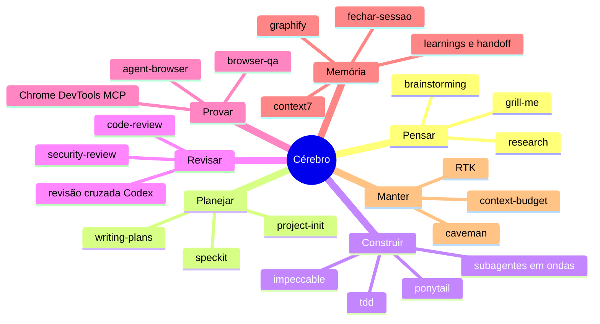

# Mapa de skills

As skills que eu uso no dia a dia com o Claude Code e o Codex, organizadas pelo momento do trabalho. Não é para instalar tudo: comece pelo [harness base](../../HARNESS.md) e acrescente o resto quando a dor aparecer.

## Pensar — antes de qualquer código

| Skill | Quando usar | De onde vem |
|---|---|---|
| `grill-me` | Você tem uma ideia ou um plano e quer que alguém aperte até achar o furo. O agente pergunta uma coisa por vez e não deixa passar resposta vaga. | [mattpocock/skills](https://github.com/mattpocock/skills) |
| `brainstorming` | Pedido criativo ou aberto. Explora a intenção antes de desenhar. | [Superpowers](../tools/01-superpowers.md) |
| `research` | Precisa de fato atual (API, versão, preço). Lê fonte primária e grava o achado. | mattpocock/skills |

## Planejar

| Skill | Quando usar | De onde vem |
|---|---|---|
| `writing-plans` | Feature com mais de um passo. Plano executável antes de editar. | Superpowers |
| `speckit` | Feature grande: constituição → spec → plano → tarefas → código → conferência. Só com `/speckit`. | [skills/speckit](../../skills/speckit/SKILL.md) (própria) |
| `project-init` | Projeto do zero. Cria `acceptance_criteria.md`, `learnings.md` e o ciclo de trabalho. | [skills/project-init](../../skills/project-init/SKILL.md) (própria) |

## Construir

| Skill | Quando usar | De onde vem |
|---|---|---|
| `ponytail` | Sempre que for escrever código. Força a menor solução que funciona: biblioteca padrão antes de dependência, uma linha antes de cinquenta. | [Ponytail](../tools/04-ponytail.md) |
| `tdd` | Comportamento testável. Vermelho → verde → refatorar. | mattpocock/skills |
| Subagentes em ondas | Tarefas independentes em paralelo, um escritor por arquivo. | [Orquestração](../tools/02-subagent-orchestration.md) |
| `impeccable` | Interface: desenhar, auditar, polir. | [pbakaus/impeccable](https://github.com/pbakaus/impeccable) |

## Revisar — quem escreve não revisa

| Skill | Quando usar | De onde vem |
|---|---|---|
| `code-review` | Antes de entregar. Revisa padrão do repositório e aderência à spec em paralelo. | mattpocock/skills |
| Revisão cruzada Codex | O Claude escreveu? O Codex revisa só leitura (e vice-versa). | [Como fazer](revisao-cruzada-codex.md) |
| `security-review` | Mudança que mexe em login, dado de cliente ou fronteira de confiança. | [Revisão de segurança](../tools/20-security-review.md) |

## Provar — tela vista, não tela imaginada

| Skill | Quando usar | De onde vem |
|---|---|---|
| `browser-qa` | Depois de mexer em UI: screenshot em 375, 768 e 1440 px. | [affaan-m/ECC](https://github.com/affaan-m/ECC) |
| `agent-browser` | Navegar, clicar e conferir fluxo como usuário real. | [agent-browser](../tools/11-agent-browser.md) |
| Chrome DevTools MCP | Console, rede e performance. | [Chrome DevTools MCP](../tools/14-chrome-devtools-mcp.md) |

## Memória — a próxima sessão começa sabendo

| Skill | Quando usar | De onde vem |
|---|---|---|
| `learnings.md` + `HANDOFF.md` | Todo projeto. Erro → causa → correção; estado real e próximo passo. | [Disciplina de sessão](disciplina-de-sessao.md) |
| `fechar-sessao` | Fim do dia. Grava aprendizado, preferência e estado, cada um no lugar certo. | [skills/fechar-sessao](../../skills/fechar-sessao/SKILL.md) (própria) |
| `graphify` | Projeto grande: grafo de quem depende de quem. | [Graphify](../tools/07-graphify.md) |
| `context7` | Documentação atual da biblioteca, em vez da memória do modelo. | [Context7](../tools/12-context7.md) |

## Manter — o harness não pode virar peso morto

| Skill | Quando usar | De onde vem |
|---|---|---|
| `context-budget` | Uma vez por mês ou quando a sessão ficar lenta. Mostra o que está pesando. | [skills/context-budget](../../skills/context-budget/SKILL.md) (própria) |
| `caveman` | Respostas curtas na conversa; código e docs com redação normal. | [Caveman](../tools/05-caveman.md) |
| RTK | Corta saída repetitiva de comando. | [RTK](../tools/03-rtk-token-proxy.md) |

## Botão de desligar

Se uma skill disparar demais ou fora de hora: desinstale o plugin, ou renomeie `~/.claude/skills` para `~/.claude/skills.bak` e todas desligam de uma vez. Reversível a qualquer momento.
